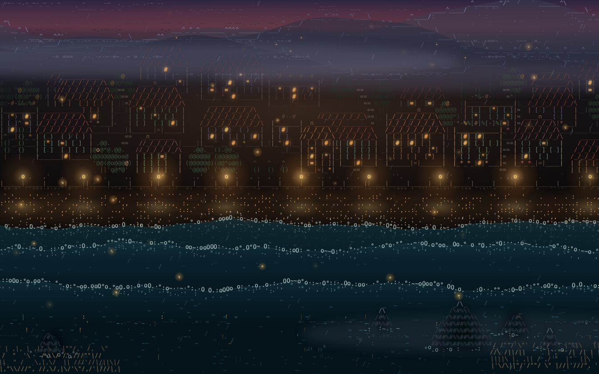

# Lantern Isle

A custom theme mod for Claude Code on desktop and mobile: a lamp-lit seaside village at blue hour, drawn entirely in ASCII.



## What you'll see

- **Twilight sky:** rose and plum at the top, over three layers of misty mountain ridges.
- **Drifting sea fog** rolling across the ridges and low over the water.
- **A terraced hillside village:** terracotta and ochre tile roofs, stone walls, arched windows, flower boxes, bell towers, olive trees and cypresses, with stairs winding down to the sea.
- **Warm lantern light** along the seawall, spilling amber onto the beach.
- **Waves and sea foam** washing up the sand and pulling back, splashing at the edge and leaving a lace of foam behind.
- **Sea stacks** standing in the water with foam around their bases.
- **Fireflies:** tiny, scattered, with a soft warm glow.
- **Light rain**, with small rain rings on the sea.
- **Coastal grass** swaying in the bottom corners.

The color theme is dark only: near-black with a slight blue-violet tint. The accent is lantern gold, with sea foam green, terracotta and dusky rose.

## Install

Copy this folder into your Claude Code plugins, or add this repository as a marketplace:

```
/plugin marketplace add <your-github-username>/lantern-isle
/plugin install lantern-isle@lantern-isle
```

## Regenerate the scene

The backdrop SVG is generated. Edit `tools/generate-scene.js`, then rebuild `hooks/scene.ts`:

```
node tools/generate-scene.js /tmp hooks/scene.ts
```

The scene must stay under 131,072 characters.

## Files

- `hooks/register.tsx`: sets the color theme and draws the animated backdrop.
- `hooks/scene.ts`: the generated ASCII scene, an animated SVG.
- `hooks/make-colors.js`: Claude Code's helper that turns a few anchor colors into a full theme.
- `tools/generate-scene.js`: the scene generator.
